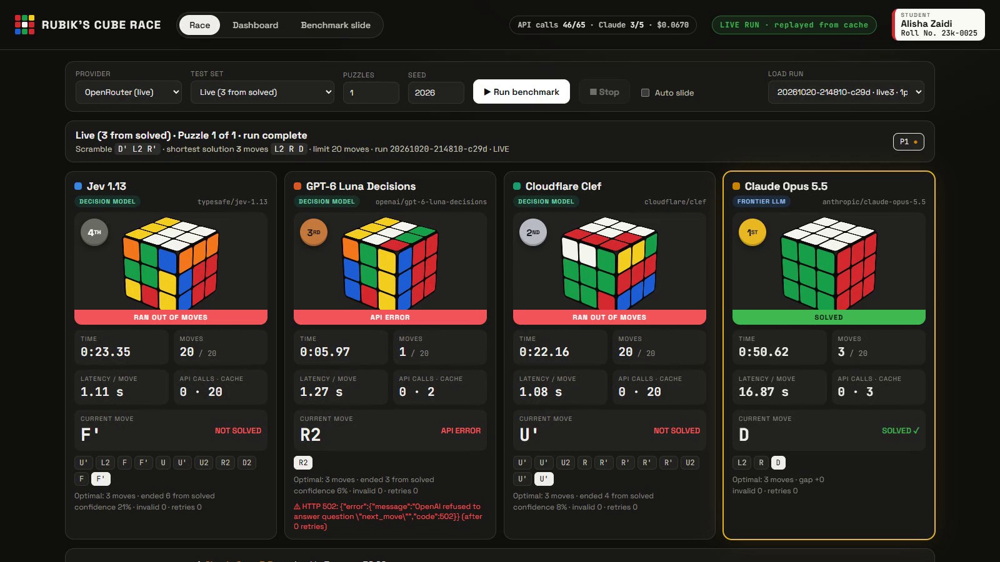
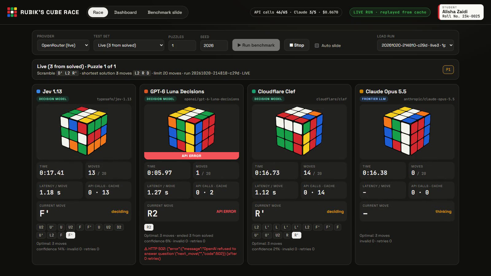
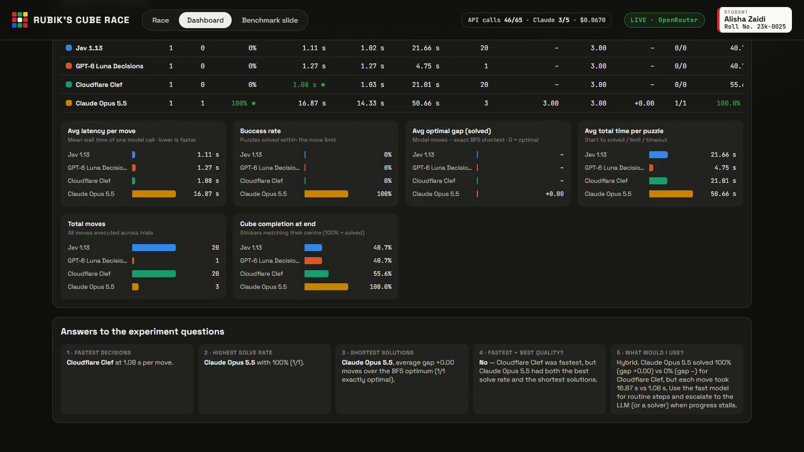
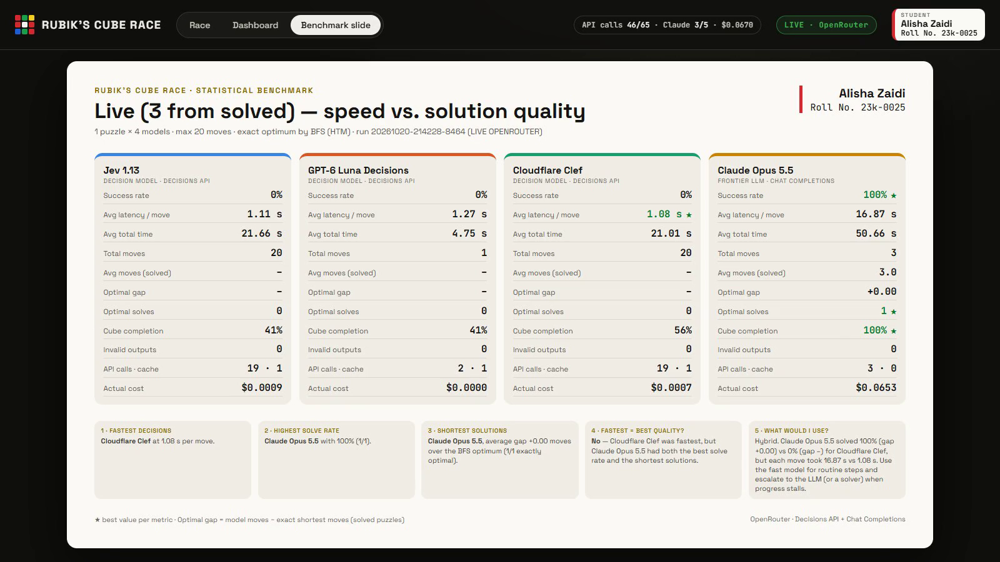
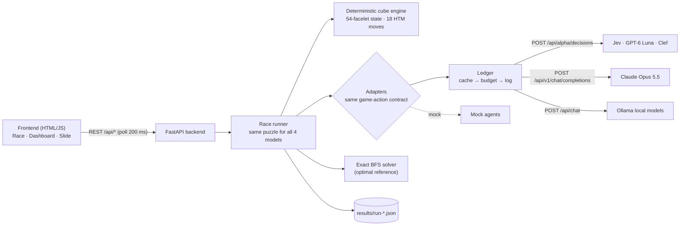

# Rubik's Cube Race — fast decision models vs. a frontier LLM

**AI Engineering · Assignment 02** · Alisha Zaidi · Roll No. 23k-0025

Can a model that decides in milliseconds beat a frontier LLM that plans for seconds, if the slower
model solves the cube in fewer moves? This repository is a full-stack benchmark (FastAPI backend +
HTML/JS frontend) that tests it with a controlled, budget-capped experiment through **OpenRouter**,
plus free local experiments on **Ollama**:

| Model | Category | OpenRouter ID | Interface |
|---|---|---|---|
| Jev 1.13 | System-1 decision model | `typesafe/jev-1.13` | Decisions API |
| OpenAI GPT-6 Luna Decisions | System-1 decision model | `openai/gpt-6-luna-decisions` | Decisions API |
| Cloudflare Clef | System-1 decision model | `cloudflare/clef` | Decisions API |
| Claude Opus 5.5 | Frontier LLM | `anthropic/claude-opus-5.5` | Chat Completions (JSON schema) |

---

## 🎥 Demo screen-recording

[](docs/demo.mp4)

**▶ Direct link to the recording: [docs/demo.mp4](docs/demo.mp4)** (1 min 41 s, 1600×900, MP4/H.264)

The recording covers the four required points:

| # | PDF requirement | Where in the video |
|---|---|---|
| 1 | **In-progress stage**: models are playing | 0:06–1:00: four cubes turning, ticking timers, `deciding…` / `thinking…` |
| 2 | **Completion stage**: models have completed the game | 1:00–1:14: medals 1st–4th, `SOLVED` / `RAN OUT OF MOVES` / `API ERROR`, results banner |
| 3 | **Slide with the statistical benchmarks** at the end | 1:16–1:27 dashboard, then 1:27–1:41 the benchmark slide |
| 4 | **Name and roll number visible during the entire demo** | top-right badge in every frame (*Alisha Zaidi · Roll No. 23k-0025*), and on the slide |

**What the video shows.** It is the **live OpenRouter experiment** from section 6.1: every move,
every API response and every latency are the real ones. The race was played live once (46 of the
65 allowed requests). The recorder's first attempt ended its capture too early, and Claude had only 2
requests left, so the race was **replayed from the persistent response cache** at the originally
measured latencies (`CACHE_ONLY=1 CACHE_REPLAY_REALTIME=1`). That replay sends **zero requests**:
the budget meter stays at 46/65, the mode badge reads `LIVE RUN · replayed from cache`, and the
cards show `API calls · cache = 0 · n`. The replay matches the live run move for move. The
dashboard and slide then load the original live run, with its real request counts and cost.

| In progress | Completed |
|---|---|
|  |  |

| Statistical dashboard | Benchmark slide (end of the recording) |
|---|---|
|  |  |

---

## Contents

1. [Quick start (mock mode, no key)](#1-quick-start-mock-mode-no-api-key-needed)
2. [Running the live experiment with the real API key](#2-running-the-live-experiment-with-the-real-api-key)
3. [Running on Ollama (local open models)](#3-running-on-ollama-local-open-models)
4. [API budget, caching and logging](#4-api-budget-caching-and-logging)
5. [How it works](#5-how-it-works)
6. [Results](#6-results)
7. [Analysis — answers to the five questions](#7-analysis--answers-to-the-five-questions)
8. [Project structure and configuration](#8-project-structure-and-configuration)

---

## 1. Quick start (mock mode, no API key needed)

**Requirements:** Python 3.10+.

```bash
python -m venv .venv
# Windows: .venv\Scripts\activate      macOS/Linux: source .venv/bin/activate
pip install -r requirements.txt

cp .env.example .env            # Windows PowerShell: Copy-Item .env.example .env
uvicorn app.main:app --app-dir backend --port 8000
# open http://localhost:8000, keep Provider = "Mock (simulated)", press "Run benchmark"
```

With `OPENROUTER_API_KEY=mock` **everything works offline**: the race UI, dashboard, slide, CLI and
report. The mock agents build the *exact same request payloads* as the real adapters and go through
the same parsing and validation. The header shows **MOCK MODE · simulated** so mock numbers are never
mistaken for real ones. `MOCK_LATENCY_SCALE=0.1` makes a mock demo 10× faster.

Tests (engine, BFS solver, adapters, budget/cache, API): `cd backend && python -m pytest -q`

**Port already in use** (`[Errno 10048]`): another server is on 8000. Stop it or use `--port 8001`.

## 2. Running the live experiment with the real API key

> The course key has a **hard limit of 100 requests** and is disabled if exceeded. The backend
> enforces stricter limits itself: **Claude ≤ 5 requests, each decision model ≤ 20, total ≤ 65**,
> counted per actual HTTP attempt (failures and retries included), saved to disk, and never reset
> by a restart (section 4). Plan and debug in mock or Ollama first.

1. Put the key and your identity in **`.env`** (git-ignored, never commit it):

   ```ini
   OPENROUTER_API_KEY=sk-or-v1-...
   STUDENT_NAME=Your Full Name
   STUDENT_ROLL=Roll No. XX-XXXX
   ```

2. Check the model IDs on OpenRouter's public listing. It needs no key and costs nothing:
   `https://openrouter.ai/api/v1/models?output_modalities=decisions` lists the three decision models.
3. *(Recommended)* **Preflight**: send each decision model only the first move of the exact puzzle the
   run will use. If the request format were wrong, you would lose 1 call instead of a whole run. If
   it is right, the answer is cached and the run reuses it for free:

   ```bash
   python backend/run_benchmark.py preflight --seed 2026 --provider live --yes-spend-budget --models jev,luna,clef
   ```

4. Start the app, choose **Provider → OpenRouter (live)**. That selects the **Live (3 from solved)**
   set, 1 puzzle. Enter the seed (`2026` was used) and press **Run benchmark**. A confirmation dialog
   shows the remaining budget. Or headless:

   ```bash
   python backend/run_benchmark.py run --provider live --set live3 --seed 2026 --yes-spend-budget
   ```

5. `python backend/run_benchmark.py budget` prints the counters; `... report` rewrites section 6.

**Re-recording without spending anything:** start the server with `CACHE_ONLY=1 CACHE_REPLAY_REALTIME=1`
and run the same provider/set/seed. Every response is served from the cache at its original live
latency, and any request that was never made live fails instead of being sent.

The key is read only by the backend; `/api/config` reports only *whether* a key is set, and the
browser talks only to the local backend.

## 3. Running on Ollama (local open models)

Ollama has no Decisions API and no Jev/Luna/Opus, so each slot gets a local open model. Every slot
gets the same chat prompt and the same JSON-schema move contract.

| Slot | Ollama model | Why |
|---|---|---|
| Jev 1.13 (System-1) | `gemma3:1b` | small, fast |
| GPT-6 Luna (System-1) | `llama3.2:1b` | small, fast |
| Cloudflare Clef (System-1) | `qwen2.5:1.5b` | small, fast |
| Claude Opus 5.5 (frontier) | `qwen3:4b` | the largest "frontier-style" open model that fits the 8 GB GPU used |

Clef is in the Ollama library, but only as the full **27B** model (≈ 20 GB; `clef-flash` is ≈ 10.6 GB).
Neither fits an 8 GB GPU, so a small open model stands in for that slot. Change any mapping with
`OLLAMA_MODEL_*` in `.env`.

```bash
ollama pull gemma3:1b && ollama pull llama3.2:1b && ollama pull qwen2.5:1.5b && ollama pull qwen3:4b
python backend/run_benchmark.py run --provider ollama --set primary --puzzles 5 --seed 42
```

Or choose **Provider → Ollama (local)** in the UI. It is free, but still cached and logged. For fair
latency on a single GPU, Ollama trials run one model at a time, and each model is loaded before its
clock starts.

## 4. API budget, caching and logging

All real requests (OpenRouter and Ollama) go through one function, `_HttpAdapter._request`
(`backend/app/adapters.py`), backed by `backend/app/ledger.py`:

```
cache lookup ──hit──▶ reuse response (0 requests; latency logged separately as "served")
     │miss
     ▼
budget.reserve(model)  ← checked and saved to disk BEFORE every attempt, retries included
     │ok                  (Claude ≤ 5 · each decision model ≤ 20 · total ≤ 65)
     ▼
HTTP request ──▶ log (latency, usage, cost, counters) ──▶ cache store (incl. final errors)
```

* **Budget**: `state/api_budget.json`. One count per *actual* HTTP attempt, including failures and
  retries. It is written atomically before the request is sent and is never reset. When a model's
  budget is used up, its trial ends as **not solved** (`API budget reached`). The CLI refuses
  `--provider live` without `--yes-spend-budget`, and the UI asks for confirmation.
* **Cache**: `state/api_cache.json`. The key is the SHA-256 of provider + endpoint + the exact request
  body + the occurrence number of that request in the trial, so a re-ask after an invalid answer is a
  fresh call while a replay reproduces the same sequence. Final failures are cached too, so a replay
  reproduces them without a call. Restarting the app keeps everything.
* **Log**: `state/api_log.jsonl`. One line per attempt (`request_ok`, `request_failed`), per
  `cache_hit`, and per `budget_block`, with latency, tokens, cost and the counters at that moment.
* **Bounded loops only**: every trial stops at solved, 20 moves, 5 invalid outputs, the time limit,
  or the budget, whichever comes first.
* **Metrics per trial**: solve status, moves, live latency (measured now) vs. cache-served time,
  optimality gap, API calls, cache hits and the **actual cost reported by OpenRouter**
  (`usage.cost`).

## 5. How it works



**State / action space (the "Snake game" framing).** *State*: the cube as a 54-character facelet
string (URFDLB order; `UUUUUUUUURRRRRRRRRFFFFFFFFFDDDDDDDDDLLLLLLLLLBBBBBBBBB` is solved), the same
data as three rows per face, the last 6 moves, moves made and moves remaining. *Action*: exactly one
of the **18 face moves** (`U U' U2 R R' R2 F F' F2 D D' D2 L L' L2 B B' B2`). *Terminal*: solved, or
a limit is reached.

**Deterministic engine** (`cube.py`). Each sticker has a 3D position and normal, and a face turn
rotates its layer by 90°. Moves are precomputed permutations, and every model uses the same engine.
Tests check the Kociemba string after `R`, the move orders, `(R U R' U')`⁶ = I and `(R U)`¹⁰⁵ = I.

**Exact optimum** (`solver.py`). A meet-in-the-middle BFS (backward table to depth 4 plus forward
search to depth 4) gives the exact shortest solution (half-turn metric) for any state up to 8 moves.
The live puzzle is *verified* to be exactly 3 moves from solved.

**Decision models: Decisions API.** One typed `choice` question whose `criteria` are the 18 moves.
The request is identical for the three models except `model`, and the move comes from
`answers.next_move.choice`. `confidence` and `probabilities` are recorded.

**Frontier LLM: Chat Completions.** The same state, instructions, criteria and recent-move policy.
The answer is constrained by a strict JSON schema `{"move": <enum of 18>}`, with
`provider.require_parameters`, `reasoning.effort = medium` and `usage.include` (actual cost).

**Validation.** Parsing is strict. A missing field, an illegal move, prose, or a code-fenced answer is
an **invalid output**: logged and counted, never coerced into a move.

### Experiment design

| Test set | Scramble | Purpose | Provider used |
|---|---|---|---|
| **Live (3 from solved)** | exactly 3 moves from solved (BFS-verified) | the one budgeted OpenRouter experiment | OpenRouter |
| Warm-up | 3–4 turns | verify adapters, validation, engine | Ollama, mock |
| Primary benchmark | 4–5 turns | main comparison, exact optimum known | Ollama, mock |
| Extension | 15–20 turns | behaviour on hard states | mock |

Same rules for every model: the same starting state, engine, 18-move action set, state serialisation,
instructions and recent-move window. **Move limit 20** (reaching it = not solved). Same timeout
(180 s per request, 900 s per trial) and retry policy (1 retry on timeouts/429/5xx, none on other
4xx). Each retry is logged and counted against the budget.

## 6. Results

Generated by `python backend/run_benchmark.py report` from `results/run-*.json` (per-move logs,
latencies, sources, invalid outputs, final states) and `state/` (budget, cache, log). Cache replays
are excluded, so they never double-count.

<!-- RESULTS:START -->
Generated 2026-10-20 23:01 from `results/run-*.json` and `state/`.

### 6.1 Live OpenRouter experiment

> **Live OpenRouter runs** — real API calls, budget-capped (see the API budget table).

Runs included: **1** · generated 2026-10-20 23:01

#### Live (3 from solved) — exactly 3 moves from solved (BFS-verified) — 1 puzzle

| Model | Type | Trials | Solved | Success rate | Avg latency / move | Avg total time | Total moves | Avg moves (solved) | Avg optimal | Optimal gap | Gap = 0 | Cube completion | Invalid outputs | Retries | API calls | Cache hits | Cost (USD) |
|---|---|---:|---:|---:|---:|---:|---:|---:|---:|---:|---:|---:|---:|---:|---:|---:|---:|
| Jev 1.13 | Decision | 1 | 0 | 0% | 1109 ms | 21.66 s | 20 | – | 3.00 | – | 0/0 | 40.7% | 0 | 0 | 19 | 1 | 0.000855 |
| GPT-6 Luna Decisions | Decision | 1 | 0 | 0% | 1266 ms | 4.75 s | 1 | – | 3.00 | – | 0/0 | 40.7% | 0 | 1 | 2 | 1 | 0.000000 |
| Cloudflare Clef | Decision | 1 | 0 | 0% | 1084 ms | 21.01 s | 20 | – | 3.00 | – | 0/0 | 55.6% | 0 | 0 | 19 | 1 | 0.000717 |
| Claude Opus 5.5 | Frontier LLM | 1 | 1 | 100% | 16869 ms | 50.66 s | 3 | 3.00 | 3.00 | 0.00 | 1/1 | 100.0% | 0 | 0 | 3 | 0 | 0.065324 |

Fastest decisions: **Cloudflare Clef** · highest solve rate: **Claude Opus 5.5** · shortest solutions: **Claude Opus 5.5**

#### Per-puzzle results

| Run | Set | # | Scramble | Optimal | Jev 1.13 | GPT-6 Luna Decisions | Cloudflare Clef | Claude Opus 5.5 |
|---|---|---:|---|---:|---|---|---|---|
| `20261020-214228-8464` | live3 | 1 | `D' L2 R'` | 3 | ❌ 20 mv, 21.66 s (move_limit) | ❌ 1 mv, 4.75 s (api_error) | ❌ 20 mv, 21.01 s (move_limit) | ✅ 3 mv, 50.66 s |


### 6.2 Ollama experiments (local open models)

> **Ollama runs** — real local open models standing in for each slot (free, no API budget).

Runs included: **1** · generated 2026-10-20 23:01

#### Live (3 from solved) — exactly 3 moves from solved (BFS-verified) — 1 puzzle

| Model | Type | Trials | Solved | Success rate | Avg latency / move | Avg total time | Total moves | Avg moves (solved) | Avg optimal | Optimal gap | Gap = 0 | Cube completion | Invalid outputs | Retries | API calls | Cache hits | Cost (USD) |
|---|---|---:|---:|---:|---:|---:|---:|---:|---:|---:|---:|---:|---:|---:|---:|---:|---:|
| Jev 1.13 slot → `gemma3:1b` | Decision | 1 | 0 | 0% | 288 ms | 6.77 s | 20 | – | 3.00 | – | 0/0 | 40.7% | 0 | 0 | 20 | 0 | 0.000000 |
| GPT-6 Luna Decisions slot → `llama3.2:1b` | Decision | 1 | 0 | 0% | 232 ms | 5.66 s | 20 | – | 3.00 | – | 0/0 | 42.6% | 0 | 0 | 20 | 0 | 0.000000 |
| Cloudflare Clef slot → `qwen2.5:1.5b` | Decision | 1 | 0 | 0% | 292 ms | 6.91 s | 20 | – | 3.00 | – | 0/0 | 31.5% | 0 | 0 | 20 | 0 | 0.000000 |
| Claude Opus 5.5 slot → `qwen3:4b` | Frontier LLM | 1 | 0 | 0% | 123146 ms | 15:00.01 min | 6 | – | 3.00 | – | 0/0 | 37.0% | 1 | 0 | 7 | 0 | 0.000000 |

Fastest decisions: **GPT-6 Luna Decisions** · highest solve rate: **–** · shortest solutions: **–**

#### Per-puzzle results

| Run | Set | # | Scramble | Optimal | Jev 1.13 | GPT-6 Luna Decisions | Cloudflare Clef | Claude Opus 5.5 |
|---|---|---:|---|---:|---|---|---|---|
| `20261020-224108-5c01` | live3 | 1 | `D' L2 R'` | 3 | ❌ 20 mv, 6.77 s (move_limit) | ❌ 20 mv, 5.66 s (move_limit) | ❌ 20 mv, 6.91 s (move_limit) | ❌ 6 mv, 15:00.01 min (out_of_time) |


### 6.3 Mock runs (pipeline verification only)

> **Mock runs** — simulated models, no API calls. These only verify the pipeline.

Runs included: **6** · generated 2026-10-20 23:01

#### Primary benchmark (4–5 scramble turns) — 22 puzzles

| Model | Type | Trials | Solved | Success rate | Avg latency / move | Avg total time | Total moves | Avg moves (solved) | Avg optimal | Optimal gap | Gap = 0 | Cube completion | Invalid outputs | Retries | API calls | Cache hits | Cost (USD) |
|---|---|---:|---:|---:|---:|---:|---:|---:|---:|---:|---:|---:|---:|---:|---:|---:|---:|
| Jev 1.13 | Decision | 22 | 20 | 91% | 329 ms | 3.57 s | 236 | 8.80 | 4.36 | 4.40 | 8/20 | 95.1% | 0 | 0 | 0 | 0 | 0.000000 |
| GPT-6 Luna Decisions | Decision | 22 | 17 | 77% | 462 ms | 7.42 s | 349 | 11.71 | 4.36 | 7.41 | 3/17 | 86.1% | 0 | 0 | 0 | 0 | 0.000000 |
| Cloudflare Clef | Decision | 22 | 9 | 41% | 226 ms | 5.19 s | 486 | 10.67 | 4.36 | 6.44 | 3/9 | 63.3% | 0 | 0 | 0 | 0 | 0.000000 |
| Claude Opus 5.5 | Frontier LLM | 22 | 22 | 100% | 5457 ms | 25.80 s | 101 | 4.59 | 4.36 | 0.23 | 19/22 | 100.0% | 3 | 0 | 0 | 0 | 0.000000 |

Fastest decisions: **Cloudflare Clef** · highest solve rate: **Claude Opus 5.5** · shortest solutions: **Claude Opus 5.5**

#### Warm-up (3–4 scramble turns) — 3 puzzles

| Model | Type | Trials | Solved | Success rate | Avg latency / move | Avg total time | Total moves | Avg moves (solved) | Avg optimal | Optimal gap | Gap = 0 | Cube completion | Invalid outputs | Retries | API calls | Cache hits | Cost (USD) |
|---|---|---:|---:|---:|---:|---:|---:|---:|---:|---:|---:|---:|---:|---:|---:|---:|---:|
| Jev 1.13 | Decision | 3 | 3 | 100% | 346 ms | 3.83 s | 33 | 11.00 | 3.67 | 7.33 | 0/3 | 100.0% | 0 | 0 | 0 | 0 | 0.000000 |
| GPT-6 Luna Decisions | Decision | 3 | 2 | 67% | 523 ms | 6.75 s | 38 | 4.00 | 3.67 | 0.50 | 1/2 | 77.8% | 0 | 0 | 0 | 0 | 0.000000 |
| Cloudflare Clef | Decision | 3 | 2 | 67% | 208 ms | 2.92 s | 41 | 5.50 | 3.67 | 2.00 | 1/2 | 79.6% | 0 | 0 | 0 | 0 | 0.000000 |
| Claude Opus 5.5 | Frontier LLM | 3 | 3 | 100% | 5294 ms | 19.42 s | 11 | 3.67 | 3.67 | 0.00 | 3/3 | 100.0% | 0 | 0 | 0 | 0 | 0.000000 |

Fastest decisions: **Cloudflare Clef** · highest solve rate: **tie: Jev 1.13 & Claude Opus 5.5** · shortest solutions: **Claude Opus 5.5**

#### Extension (15–20 scramble turns) — 3 puzzles

| Model | Type | Trials | Solved | Success rate | Avg latency / move | Avg total time | Total moves | Avg moves (solved) | Avg optimal | Optimal gap | Gap = 0 | Cube completion | Invalid outputs | Retries | API calls | Cache hits | Cost (USD) |
|---|---|---:|---:|---:|---:|---:|---:|---:|---:|---:|---:|---:|---:|---:|---:|---:|---:|
| Jev 1.13 | Decision | 3 | 0 | 0% | 323 ms | 10.14 s | 90 | – | – | – | 0/0 | 38.9% | 0 | 0 | 0 | 0 | 0.000000 |
| GPT-6 Luna Decisions | Decision | 3 | 0 | 0% | 489 ms | 15.09 s | 90 | – | – | – | 0/0 | 34.0% | 0 | 0 | 0 | 0 | 0.000000 |
| Cloudflare Clef | Decision | 3 | 0 | 0% | 215 ms | 6.89 s | 90 | – | – | – | 0/0 | 38.3% | 0 | 0 | 0 | 0 | 0.000000 |
| Claude Opus 5.5 | Frontier LLM | 3 | 0 | 0% | 5836 ms | 2:57.40 min | 90 | – | – | – | 0/0 | 36.4% | 1 | 0 | 0 | 0 | 0.000000 |

Fastest decisions: **Cloudflare Clef** · highest solve rate: **–** · shortest solutions: **–**

#### All test sets — 28 puzzles

| Model | Type | Trials | Solved | Success rate | Avg latency / move | Avg total time | Total moves | Avg moves (solved) | Avg optimal | Optimal gap | Gap = 0 | Cube completion | Invalid outputs | Retries | API calls | Cache hits | Cost (USD) |
|---|---|---:|---:|---:|---:|---:|---:|---:|---:|---:|---:|---:|---:|---:|---:|---:|---:|
| Jev 1.13 | Decision | 28 | 23 | 82% | 329 ms | 4.30 s | 359 | 9.09 | 4.28 | 4.78 | 8/23 | 89.6% | 0 | 0 | 0 | 0 | 0.000000 |
| GPT-6 Luna Decisions | Decision | 28 | 19 | 68% | 472 ms | 8.17 s | 477 | 10.89 | 4.28 | 6.68 | 4/19 | 79.6% | 0 | 0 | 0 | 0 | 0.000000 |
| Cloudflare Clef | Decision | 28 | 11 | 39% | 223 ms | 5.13 s | 617 | 9.73 | 4.28 | 5.64 | 4/11 | 62.4% | 0 | 0 | 0 | 0 | 0.000000 |
| Claude Opus 5.5 | Frontier LLM | 28 | 25 | 89% | 5616 ms | 41.36 s | 202 | 4.48 | 4.28 | 0.20 | 22/25 | 93.2% | 4 | 0 | 0 | 0 | 0.000000 |

Fastest decisions: **Cloudflare Clef** · highest solve rate: **Claude Opus 5.5** · shortest solutions: **Claude Opus 5.5**

#### Per-puzzle results

| Run | Set | # | Scramble | Optimal | Jev 1.13 | GPT-6 Luna Decisions | Cloudflare Clef | Claude Opus 5.5 |
|---|---|---:|---|---:|---|---|---|---|
| `20261020-134939-623d` | primary | 1 | `R' B' D R'` | 4 | ❌ 30 mv, 10.91 s (move_limit) | ✅ 10 mv, 4.07 s | ❌ 30 mv, 6.88 s (move_limit) | ✅ 4 mv, 17.40 s |
| `20261020-134939-623d` | primary | 2 | `B2 R' F R2` | 4 | ✅ 6 mv, 1.91 s | ✅ 8 mv, 4.22 s | ✅ 20 mv, 4.19 s | ✅ 6 mv, 36.13 s |
| `20261020-134939-623d` | primary | 3 | `F2 B R2 B'` | 4 | ✅ 12 mv, 3.36 s | ❌ 30 mv, 14.11 s (move_limit) | ✅ 18 mv, 4.20 s | ✅ 4 mv, 19.54 s |
| `20261020-134939-623d` | primary | 4 | `D' L R2 B` | 4 | ✅ 10 mv, 3.38 s | ❌ 30 mv, 15.09 s (move_limit) | ❌ 30 mv, 7.23 s (move_limit) | ✅ 4 mv, 23.55 s |
| `20261020-134939-623d` | primary | 5 | `F2 U' F2 B' R2` | 5 | ✅ 9 mv, 2.68 s | ❌ 30 mv, 12.02 s (move_limit) | ✅ 5 mv, 1.14 s | ✅ 5 mv, 28.73 s |
| `20261020-134939-623d` | primary | 6 | `D' U2 R2 L` | 4 | ✅ 4 mv, 1.28 s | ✅ 4 mv, 1.79 s | ❌ 30 mv, 7.14 s (move_limit) | ✅ 4 mv, 18.76 s |
| `20261020-134939-623d` | primary | 7 | `B' F' R' U'` | 4 | ✅ 4 mv, 1.25 s | ✅ 28 mv, 13.54 s | ✅ 4 mv, 0.89 s | ✅ 4 mv, 15.86 s |
| `20261020-134939-623d` | primary | 8 | `L' F' U2 R2 D` | 5 | ✅ 14 mv, 4.82 s | ✅ 5 mv, 2.33 s | ❌ 30 mv, 7.44 s (move_limit) | ✅ 5 mv, 34.32 s |
| `20261020-134939-623d` | primary | 9 | `R2 L2 D' R'` | 4 | ✅ 4 mv, 1.84 s | ✅ 8 mv, 4.22 s | ✅ 11 mv, 2.68 s | ✅ 4 mv, 18.99 s |
| `20261020-134939-623d` | primary | 10 | `U2 R2 U2 R` | 4 | ✅ 4 mv, 1.12 s | ✅ 25 mv, 12.89 s | ❌ 30 mv, 6.48 s (move_limit) | ✅ 4 mv, 28.92 s |
| `20261020-134939-6515` | warmup | 1 | `B D F2` | 3 | ✅ 9 mv, 3.44 s | ✅ 3 mv, 1.58 s | ✅ 3 mv, 0.75 s | ✅ 3 mv, 16.61 s |
| `20261020-134939-6515` | warmup | 2 | `F B' L' U'` | 4 | ✅ 18 mv, 5.70 s | ❌ 30 mv, 16.29 s (move_limit) | ✅ 8 mv, 1.74 s | ✅ 4 mv, 21.59 s |
| `20261020-134939-6515` | warmup | 3 | `R' U R2 B` | 4 | ✅ 6 mv, 2.34 s | ✅ 5 mv, 2.37 s | ❌ 30 mv, 6.28 s (move_limit) | ✅ 4 mv, 20.05 s |
| `20261020-134940-e769` | extension | 1 | `D2 U2 L' B2 F2 D' F L B R D2 B2 F2 D U2 L' U' D F' D'` | – | ❌ 30 mv, 9.65 s (move_limit) | ❌ 30 mv, 14.14 s (move_limit) | ❌ 30 mv, 7.19 s (move_limit) | ❌ 30 mv, 2:56.32 min (move_limit) |
| `20261020-134940-e769` | extension | 2 | `U2 R' L' B' R2 L2 F' D2 U F U L' R2 F' D2 F B D` | – | ❌ 30 mv, 10.62 s (move_limit) | ❌ 30 mv, 15.54 s (move_limit) | ❌ 30 mv, 6.75 s (move_limit) | ❌ 30 mv, 3:05.05 min (move_limit) |
| `20261020-134940-e769` | extension | 3 | `B U' R2 U L F' R' U' L2 D2 B R' D R2 B' R2` | – | ❌ 30 mv, 10.16 s (move_limit) | ❌ 30 mv, 15.61 s (move_limit) | ❌ 30 mv, 6.74 s (move_limit) | ❌ 30 mv, 2:50.83 min (move_limit) |
| `20261020-141331-3f31` | primary | 1 | `B D' L2 B2 U` | 5 | ✅ 5 mv, 1.76 s | ❌ 30 mv, 14.56 s (move_limit) | ❌ 30 mv, 7.35 s (move_limit) | ✅ 5 mv, 36.55 s |
| `20261020-141331-3f31` | primary | 2 | `B U2 R U2` | 4 | ✅ 4 mv, 1.08 s | ✅ 6 mv, 2.40 s | ✅ 4 mv, 0.84 s | ✅ 6 mv, 30.58 s |
| `20261020-141331-3f31` | primary | 3 | `U R U2 R B` | 5 | ✅ 28 mv, 9.30 s | ✅ 8 mv, 4.59 s | ❌ 30 mv, 6.94 s (move_limit) | ✅ 6 mv, 36.83 s |
| `20261020-141331-3f31` | primary | 4 | `B L' R D2` | 4 | ✅ 24 mv, 8.05 s | ✅ 19 mv, 7.76 s | ✅ 6 mv, 1.31 s | ✅ 4 mv, 19.78 s |
| `20261020-141344-69c2` | primary | 1 | `U R B' D` | 4 | ✅ 9 mv, 3.03 s | ✅ 17 mv, 6.84 s | ❌ 30 mv, 7.33 s (move_limit) | ✅ 4 mv, 23.00 s |
| `20261020-141344-69c2` | primary | 2 | `B2 R B R' U` | 5 | ✅ 8 mv, 2.46 s | ✅ 14 mv, 6.20 s | ✅ 22 mv, 5.36 s | ✅ 5 mv, 22.29 s |
| `20261020-141344-69c2` | primary | 3 | `B2 F2 L D2 R'` | 5 | ✅ 7 mv, 2.71 s | ✅ 5 mv, 2.97 s | ❌ 30 mv, 6.58 s (move_limit) | ✅ 5 mv, 21.07 s |
| `20261020-141344-69c2` | primary | 4 | `D2 R' B' U` | 4 | ❌ 30 mv, 10.51 s (move_limit) | ✅ 18 mv, 7.43 s | ❌ 30 mv, 7.66 s (move_limit) | ✅ 4 mv, 24.93 s |
| `20261020-141344-69c2` | primary | 5 | `F2 D R' U2` | 4 | ✅ 6 mv, 1.85 s | ✅ 6 mv, 2.65 s | ✅ 6 mv, 1.26 s | ✅ 4 mv, 19.40 s |
| `20261020-141357-d9a8` | primary | 1 | `B' U' D2 L U2` | 5 | ✅ 5 mv, 1.56 s | ❌ 30 mv, 13.88 s (move_limit) | ❌ 30 mv, 7.29 s (move_limit) | ✅ 5 mv, 36.48 s |
| `20261020-141357-d9a8` | primary | 2 | `D R' F D2` | 4 | ✅ 4 mv, 0.92 s | ✅ 9 mv, 4.97 s | ❌ 30 mv, 6.90 s (move_limit) | ✅ 4 mv, 22.72 s |
| `20261020-141357-d9a8` | primary | 3 | `D2 B' U F L2` | 5 | ✅ 9 mv, 2.82 s | ✅ 9 mv, 4.75 s | ❌ 30 mv, 7.08 s (move_limit) | ✅ 5 mv, 31.82 s |


### 6.4 OpenRouter API budget (persistent counter, all attempts incl. retries/failures)

Total actual requests: **46 / 65** (key hard limit 100) · Claude limit 5 · decision-model limit 20 each · actual cost reported by OpenRouter: **$0.067044** · cached responses: 901

| Model | Actual requests |
|---|---:|
| `anthropic/claude-opus-5.5` | 3 |
| `cloudflare/clef` | 20 |
| `openai/gpt-6-luna-decisions` | 3 |
| `typesafe/jev-1.13` | 20 |

<!-- RESULTS:END -->

## 7. Analysis — answers to the five questions

Primary evidence: the **live OpenRouter experiment** (§6.1). It is one puzzle exactly 3 moves from
solved (`D' L2 R'`, optimum `L2 R D`), so it is a single trial per model, not a statistical sample.
The local Ollama run of the same puzzle (§6.2) and the mock runs (§6.3) are supporting context only.

1. **Which model is fastest at making decisions?** **Cloudflare Clef**, at **1.08 s per move**,
   then Jev 1.13 (1.11 s) and GPT-6 Luna (1.27 s, one answer). **Claude Opus 5.5 took 16.87 s per
   move**, about 16× slower. (On OpenRouter the decision models' latency includes network and
   routing, so it is roughly 1 s, not milliseconds.)
2. **Which model achieved the highest solve rate?** **Claude Opus 5.5**: solved (1/1). Jev and Clef
   used all 20 moves without solving. GPT-6 Luna made one move, then OpenRouter returned
   *"OpenAI refused to answer question next_move"* (HTTP 502) twice, so its trial ended as an API
   error.
3. **Which model found the shortest solutions, and how close to the optimum?** **Claude Opus 5.5**
   played `L2 R D`, the exact BFS optimum: **gap 0**, 3 of its 5 allowed requests, 50.7 s in total.
   The decision models' probability spreads were almost flat (confidence 4–21% across 18 options),
   so they were close to guessing. Clef's first move `L2` was optimal, but it then wandered and
   ended **4 moves** from solved; Jev ended **6 moves** away.
4. **Did the fastest model also achieve the best solution quality?** **No.** The fastest model (Clef)
   did not solve the cube. The slowest model (Opus) solved it optimally with the fewest moves:
   its **50.7 s** to a solution beat 20 fast but undirected moves (≈ 21 s) that went nowhere.
5. **Fast decision model, frontier LLM, or a hybrid in a real application?** **A hybrid, led by the
   frontier model for planning.** Evidence: on this state-tracking task only the LLM made progress
   (100% solved, gap 0), at about 75× the cost of a decision-model trial ($0.065 vs. about $0.0008).
   The decision models were 16× faster per call but produced near-uniform choices. In production I
   would use the LLM, or a classical search such as the BFS used here, to *plan* the action
   sequence. Fast decision models fit cheap, frequent, low-stakes classification where a wrong
   choice is recoverable, not multi-step search. A single puzzle is a small sample, so the
   conclusion should be confirmed with more live puzzles once more budget is available.

**Ollama (local, same puzzle).** No small local model solved it. The 1–1.5B System-1 stand-ins
answered in 0.23–0.29 s per move but repeated near-identical moves (Gemma played `U2` 20 times).
Qwen3 4B with thinking picked plausible moves but needed **≈ 123 s per move**, so it hit the 900 s
trial limit after 6 moves. That is the same speed-vs-deliberation trade-off, made worse on local
hardware. An earlier local run at temperature 0 made every small model repeat one move forever; it
is kept in `results/archive/`. Final runs use default sampling, as on OpenRouter.

## 8. Project structure and configuration

```
.
├── backend/
│   ├── app/
│   │   ├── main.py        # FastAPI app: REST API + serves the frontend
│   │   ├── cube.py        # deterministic cube engine (state, 18 moves, scrambles)
│   │   ├── solver.py      # exact meet-in-the-middle BFS (optimal reference)
│   │   ├── adapters.py    # Decisions API / Chat Completions / Ollama / Mock adapters
│   │   ├── ledger.py      # persistent API budget, response cache, request log
│   │   ├── race.py        # puzzles, trials, agent loop, ranking, persistence
│   │   ├── stats.py       # aggregate metrics + answers
│   │   ├── cli.py         # run · preflight · check · budget · report
│   │   └── config.py      # .env loading, models, test sets, limits
│   ├── tests/             # engine, solver, adapters, ledger and API tests (pytest)
│   └── run_benchmark.py   # CLI entry point
├── frontend/              # index.html, styles.css, app.js (no build step)
├── results/               # run-*.json raw results, RESULTS.md
├── state/                 # api_budget.json, api_cache.json, api_log.jsonl (persistent)
├── docs/                  # demo.mp4 (recording) + screenshots/
├── .env.example           # environment template (copy to .env)
└── requirements.txt
```

| Variable | Default | Meaning |
|---|---|---|
| `OPENROUTER_API_KEY` | `mock` | a real `sk-or-v1-…` key enables the live provider |
| `STUDENT_NAME`, `STUDENT_ROLL` | placeholders | shown on screen for the whole demo |
| `MAX_MOVES` | 20 | move limit per model per puzzle |
| `MAX_TOTAL_API_CALLS` / `MAX_CLAUDE_CALLS` / `MAX_DECISION_CALLS_PER_MODEL` | 65 / 5 / 20 | hard OpenRouter budget (persistent) |
| `KEY_HARD_LIMIT` | 100 | the key's own limit (informational) |
| `CACHE_ONLY`, `CACHE_REPLAY_REALTIME` | 0, 0 | replay from cache only, at original latency |
| `REQUEST_TIMEOUT_S` / `TRIAL_TIME_LIMIT_S` | 180 / 900 | per-request and per-trial time limits |
| `MAX_RETRIES` | 1 | transport retries (each one counts against the budget) |
| `MAX_INVALID_OUTPUTS` | 5 | malformed outputs before a trial is failed |
| `RECENT_MOVES_WINDOW` | 6 | recent-move history sent to every model |
| `OPUS_REASONING_EFFORT` | `medium` | OpenRouter `reasoning.effort` for the LLM |
| `MODEL_JEV` … `MODEL_OPUS` | IDs above | override if OpenRouter renames a model |
| `OLLAMA_BASE_URL`, `OLLAMA_MODEL_*` | localhost, see §3 | local models per slot |
| `MOCK_LATENCY_SCALE` | 1.0 | mock only: scale simulated latency |
| `PUZZLE_PAUSE_S` | 4 | UI only: pause between puzzles (never timed) |

**REST API:** `GET /api/config` · `GET /api/budget` · `POST /api/runs {test_set, puzzles, seed?, provider}`
· `GET /api/runs[/{id}]` · `POST /api/runs/{id}/cancel` · `GET /api/stats?run_id=&mode=` · `GET /api/solve?state=`

**Notes.** One run at a time (HTTP 409 otherwise). **Stop** interrupts in-flight calls, and stopped or
interrupted puzzles are excluded from the statistics. On screens 1280 px and wider, the four racers
sit side by side, and the slide scales to fit any window at 16:9. The Decisions API is an alpha
endpoint; the adapter follows its documented schema.
